# 📖 MANUAL COMPLETO DE USO DE LA APLICACIÓN
## Sistema de Gestión Integral para Eventos Musicales y Bodas
**Marcas Comerciales:** JAVNXDJ &bull; NÚÑEZ & SON  
**Plataforma Web:** [app.nunezandson.com](https://app.nunezandson.com)  
**Versión:** 2026.10 &bull; Actualizado con Capturas de Pantalla Reales

---

## 📑 Índice de Contenidos
1. [Introducción y Filosofía Multi-Marca](#1-introducción-y-filosofía-multi-marca)
2. [Acceso al Sistema y Roles de Usuario](#2-acceso-al-sistema-y-roles-de-usuario)
3. [Panel de Control (Dashboard) y Métricas](#3-panel-de-control-dashboard-y-métricas)
4. [Agenda y Gestión de Eventos](#4-agenda-y-gestión-de-eventos)
5. [Ficha del Evento y Ciclo de Vida](#5-ficha-del-evento-y-ciclo-de-vida)
6. [Seguimiento Táctico de Clientes "Sin Respuesta" (WhatsApp)](#6-seguimiento-táctico-de-clientes-sin-respuesta-whatsapp)
7. [Presupuestos Inteligentes, Packs y Efectos Especiales](#7-presupuestos-inteligentes-packs-y-efectos-especiales)
8. [Dossier Comercial y Presupuesto en PDF con Caducidad](#8-dossier-comercial-y-presupuesto-en-pdf-con-caducidad)
9. [Contratos y Firma Digital Online con Auditoría](#9-contratos-y-firma-digital-online-con-auditoría)
10. [Escaleta Musical y Peticiones de los Novios](#10-escaleta-musical-y-peticiones-de-los-novios)
11. [Modo Cabina DJ en Directo y Peticiones QR para Invitados](#11-modo-cabina-dj-en-directo-y-peticiones-qr-para-invitados)
12. [Control de Inventario y Material Técnico](#12-control-de-inventario-y-material-técnico)
13. [Calculadora Pública de Presupuestos (Web / Embed)](#13-calculadora-pública-de-presupuestos-web--embed)
14. [Resumen de Buenas Prácticas y Consejos](#14-resumen-de-buenas-prácticas-y-consejos)

---

## 1. Introducción y Filosofía Multi-Marca

La aplicación está diseñada para gestionar de forma centralizada todas las operaciones de una empresa de eventos musicales y DJ, con soporte nativo para **dos marcas comerciales independientes**:

- **JAVNXDJ**: Orientada a eventos de autor, sesiones de DJ exclusivas, música electrónica y eventos corporativos.
- **NÚÑEZ & SON (Eventos Musicales)**: Orientada a bodas integrales, ceremonias, cócteles, banquetes y montajes de sonido/iluminación completos.

Cada evento, presupuesto, contrato, correo y PDF adopta automáticamente la identidad visual, colores, logotipos, datos fiscales y cuentas bancarias de la marca seleccionada.

---

## 2. Acceso al Sistema y Roles de Usuario

- **URL de acceso oficial**: `https://app.nunezandson.com/login`
- **Inicio de sesión**: Mediante correo electrónico y contraseña.

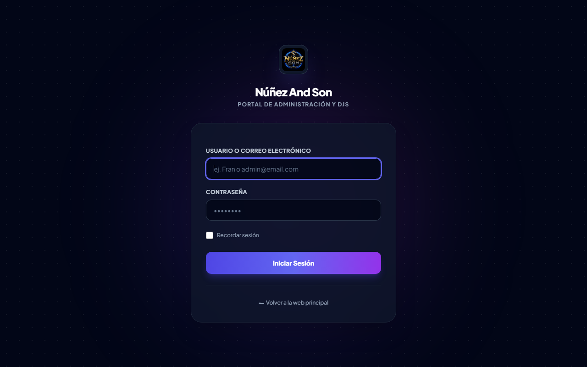
*Figura 2.1: Pantalla de inicio de sesión de Staff y Administradores.*

### Roles de Usuario:
- **Administrador**: Control total sobre eventos, finanzas, presupuestos, contratos, configuración, inventario y usuarios.
- **Staff / DJ Residente**: Acceso al calendario, detalles técnicos de eventos asignados, escaletas musicales y activación del Modo Cabina en Directo.

---

## 3. Panel de Control (Dashboard) y Métricas

Al iniciar sesión, el Dashboard ofrece una visión panorámica e inmediata del negocio:

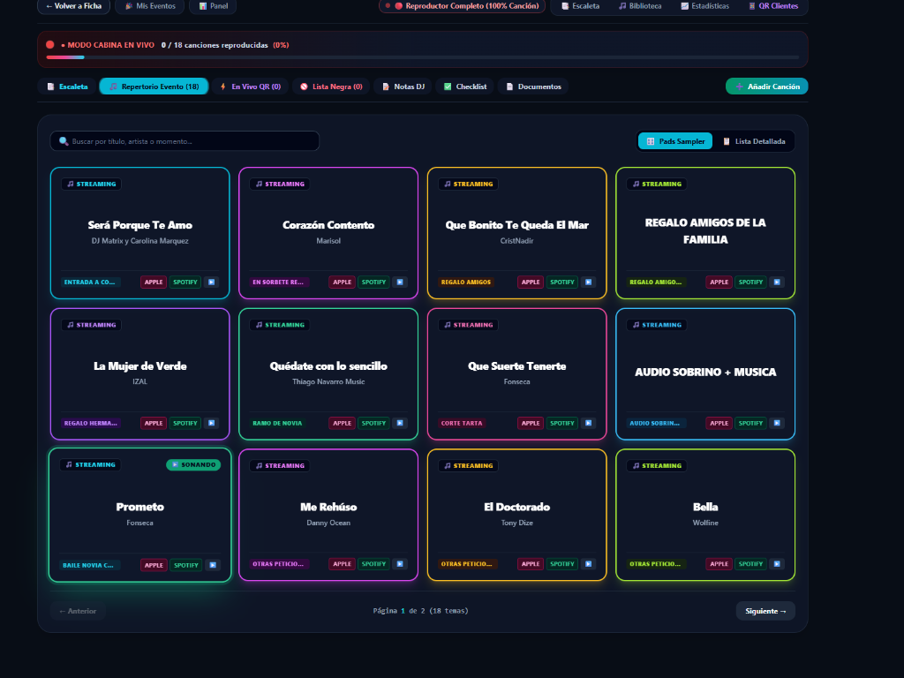
*Figura 3.1: Panel general con facturación total, facturación pendiente, banner de seguimiento activo y eventos próximos.*

### Elementos Clave:
1. **Resumen Financiero (KPIs)**: Facturación total emitida, facturas pendientes de cobro y previsión de ingresos.
2. **Banner de Seguimiento Activo**: Detecta automáticamente cuántos clientes llevan días sin responder al presupuesto y ofrece botones directos para enviar WhatsApps de reactivación sin tener que buscar ficha por ficha.
3. **Próximos Eventos**: Accesos directos a las fichas de los eventos más inmediatos.

---

## 4. Agenda, Sincronización IMAP de Leads y Validación de DNI

El módulo **Eventos** (`/admin/events`) centraliza todas las fechas y bodas de la temporada e incorpora el botón **"📩 Sincronizar Leads"** junto a **"➕ Nuevo Evento"**.

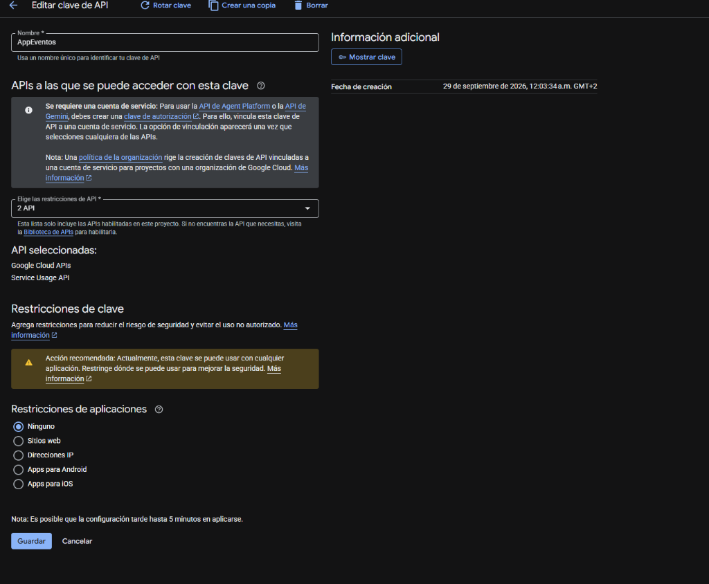
*Figura 4.1: Listado de eventos con filtros por estado, sincronización IMAP y acciones rápidas.*

### Características Principales:
- **Captura Automática de Leads por Email (IMAP)**: Escanea los buzones configurados (tanto de forma automática al entrar al Dashboard/Eventos y en segundo plano como mediante el botón manual) e importa las solicitudes de **Bodas.net**, **Madrigal Marketing** y formularios web.
- **Centro de Avisos en Tiempo Real (`🔔`) y Notificaciones Multicanal**: Tanto cuando **recibimos un nuevo Email de un Lead** como cuando **un cliente responde por WhatsApp**, la aplicación dispara un triple aviso inmediato:
  1. **En la App (Campana `🔔` superior + Notificación Push con sonido en móvil/navegador)** con acceso en 1 clic a la ficha del evento.
  2. **Por WhatsApp** a los teléfonos de notificación de los socios/administradores.
  3. **Por Correo Electrónico** a las cuentas de administración de la marca.
- **Memoria Permanente Anti-Duplicados**: Registra la huella única de cada solicitud (`imap_processed_signatures`). Si eliminas manualmente un evento, queda bloqueado para que **jamás vuelva a re-importarse** aunque el correo continúe en la bandeja de entrada.
- **Autocompletado de Letra DNI / NIE**: En todos los formularios (Clientes, Evento, Pareja, Contrato y Portal de Invitados), basta con introducir los 8 dígitos del DNI (ej. `12345678`) para que el sistema calcule y complete automáticamente la letra oficial (`12345678Z`) mostrando el indicador `✅ DNI válido`.
- **Fusión y Limpieza de Clientes**: En el apartado **Clientes / Novios** dispones de herramientas en 1 clic para fusionar contactos duplicados y eliminar registros basura sin eventos asociados.

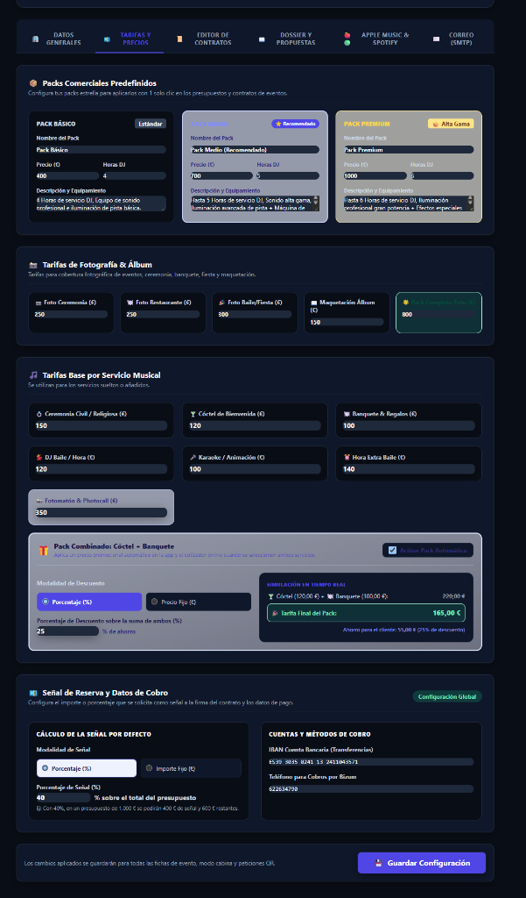
*Figura 4.2: Tarjeta táctil en smartphone con horarios de montaje y acceso a WhatsApp.*

---

## 5. Ficha del Evento y Ciclo de Vida

Al pulsar en **Gestionar**, accedemos a la ficha integral del evento con barra de pestañas adaptable en varias líneas y soporte completo para Modo Claro y Modo Oscuro:

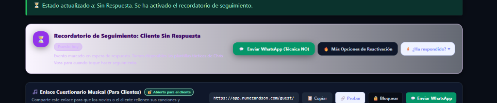
*Figura 5.1: Banner inteligente en la ficha del evento con contador de días, urgencia y acciones rápidas.*

### Estados del Evento:
- **📝 Borrador**: Petición inicial o presupuesto en preparación.
- **⏳ Sin Respuesta**: Lead entrante o presupuesto enviado pendiente de contestación.
- **🟢 Confirmado**: Señal/fianza cobrada o contrato firmado. Fecha bloqueada en exclusiva.
- **❌ Rechazado**: Cliente declinó o se descarta el expediente. Fecha liberada.

---

## 6. WhatsApp Directo (Evolution API), Método Madrigal y Posicionamiento

La ficha del evento integra envío y recepción bidireccional por **Evolution API** (cuando el cliente contesta por WhatsApp, la App envía notificación inmediata en la campana `🔔` / Push móvil / WhatsApp de socios / Email y reactiva automáticamente el evento de *Sin Respuesta* a *Borrador*) junto con el guion completo de **Plantillas Rápidas Madrigal & Comerciales**:

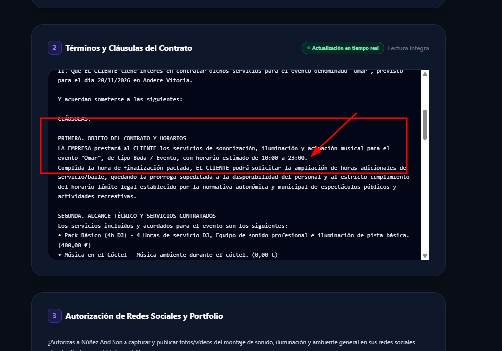
*Figura 6.1: Hub de reactivación táctica con previsualización del mensaje personalizado.*

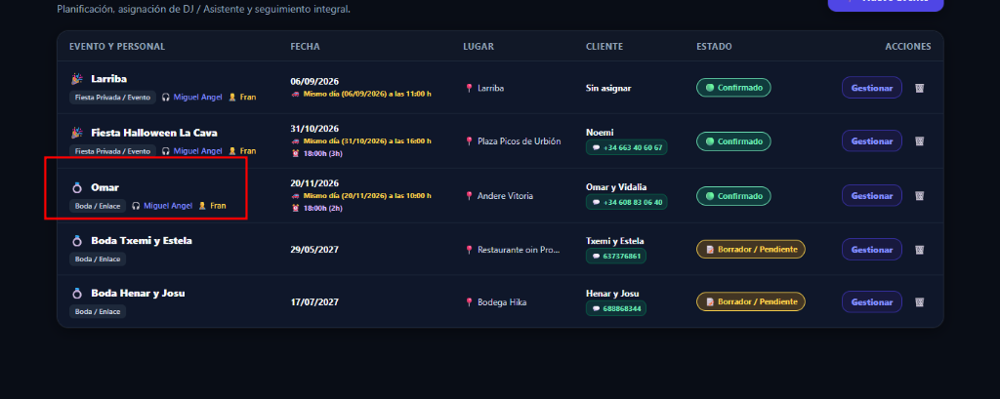
*Figura 6.2: Menú con diferentes opciones tácticas según la fase comercial.*

### Guion Completo de Plantillas Rápidas (Con Datos Ficticios de Ejemplo):
1. **👋 1er Contacto + `/presupuesto`**:  
   *«¡Hola Carlos y Laura! 👋 Acabo de consultar nuestra agenda para el 15 de junio de 2027 en Finca El Olivar y ¡tenemos la fecha disponible! 🎉 Para poder prepararos el presupuesto a medida necesitamos saber qué servicios necesitáis (ceremonia, cóctel, banquete, DJ barra libre, fuego frío...). Para ello podéis seleccionarlos directamente en 1 minuto aquí: 👉 https://app.nunezandson.com/presupuesto»*
2. **🟢 1er Contacto (Madrigal)**:  
   Guion rompehielos de descubrimiento (pregunta por la finca y estilo de fiesta antes de dar precios en frío, incluyendo también el enlace a `/presupuesto`).
3. **💡 Dudas (Día 3) y ⚡ Escasez 24h (Día 7)**:  
   Seguimiento cercano tras enviar el dossier y aviso de nueva consulta en la misma fecha otorgando 24 horas de prioridad.
4. **🎯 La Técnica del "NO" (Día 10 - Chris Voss)**:  
   *«Hola Carlos y Laura, ¿habéis decidido descartar la opción de contar con nosotros para vuestra boda el 15 de junio de 2027?»*  
   Activa una respuesta inmediata sin parecer insistente.
5. **🔒 Cierre de Expediente por Silencio (Día 15+)**:  
   Asume amablemente que han elegido otra alternativa y libera la fecha en agenda.
6. **👑 "No es nuestro cliente" (Posicionamiento ante Objeción de Precio)**:  
   Cuando responden que *"se les va de presupuesto"* y no interesa rebajar tarifas:  
   *«¡Hola Carlos y Laura! 👋 No hay ningún problema, os agradecemos mucho vuestra sinceridad. Con total transparencia y cariño, entendemos que más que tratarse de que se os vaya de presupuesto, simplemente es que no somos el perfil de servicio que estáis buscando (ni vosotros el perfil de cliente para nosotros en esta ocasión). Nosotros nunca recortamos en calidad técnica, montaje ni dedicación para competir por precio... Por nuestra parte liberamos desde este momento vuestra fecha en nuestra agenda.»*  
   *(Junto al botón alternativo **💰 Objeción Precio (Adaptar)** para cuando sí se desee ofrecer un ajuste de equipamiento).*

---

## 7. Presupuestos Inteligentes, Packs y Efectos Especiales

La pestaña **Presupuesto** automatiza la inclusión de servicios y efectos según el pack seleccionado:

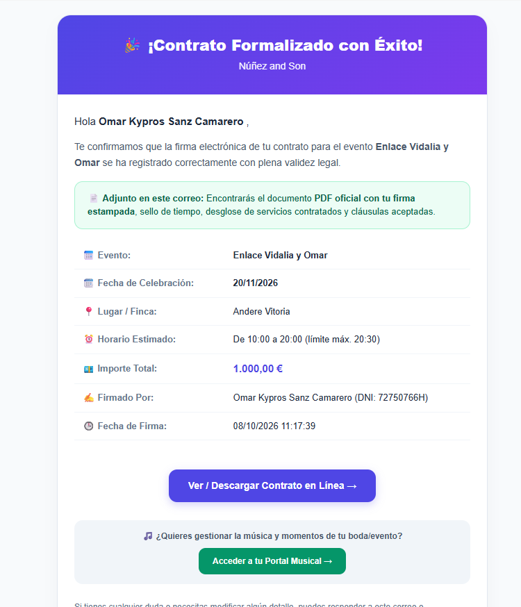
*Figura 7.1: Selección de Pack con activación automática de Máquina de Humo y Efectos.*

### Lógica Automática de Efectos:
- **Pack Básico**: Sonido e iluminación esenciales.
- **Pack Premium**: Incluye **Máquina de Humo** automáticamente a coste 0 € en el presupuesto.
- **Pack Exclusivo**: Marca automáticamente **Máquina de Humo** y **Fuego Frío** para momentos clave (entrada o baile nupcial).

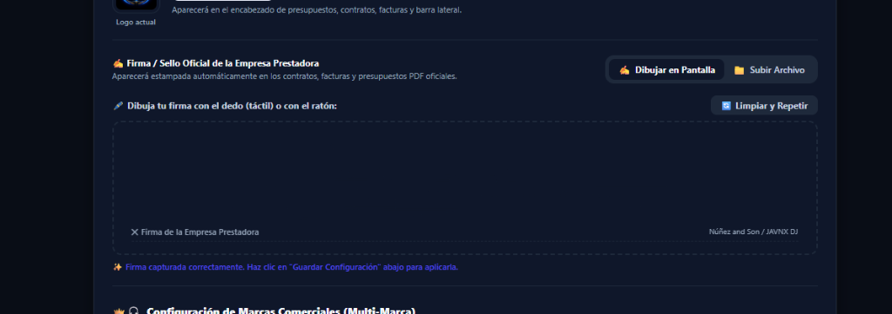
*Figura 7.2: Tarificación por máquina: 60 € por máquina física (ej. 2 máquinas = 120 €).*

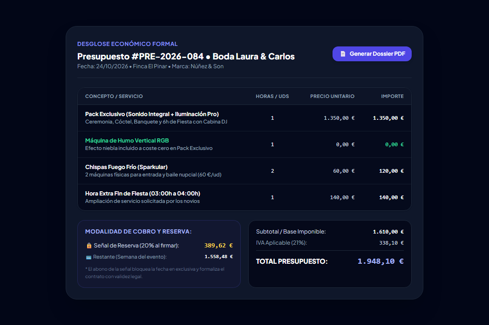
*Figura 7.3: Desglose con Base Imponible, IVA (21%) y Fianza de Reserva formal.*

---

## 8. Dossier Comercial y Presupuesto en PDF con Caducidad

El dossier descargable en PDF presenta una imagen de marca impecable e incluye **Fecha de Caducidad de la Oferta**:

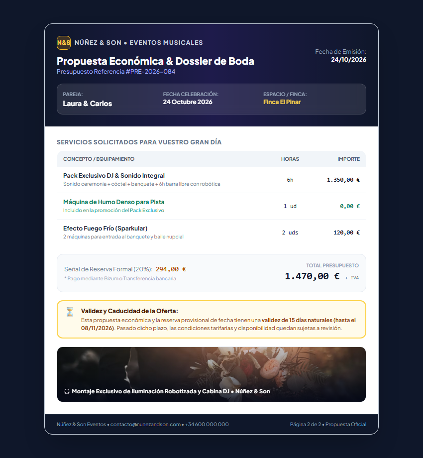
*Figura 8.1: Dossier profesional en PDF con especificación de packs y validez temporal.*

> **Protección Tarifaria:** Si un cliente tarda meses en responder y la oferta ha caducado, la empresa tiene el respaldo contractual para actualizar los precios a la temporada vigente.

---

## 9. Contratos y Firma Digital Online con Auditoría

Los novios pueden revisar su contrato y firmarlo digitalmente desde su teléfono móvil a través del enlace `/contrato/{token}`:

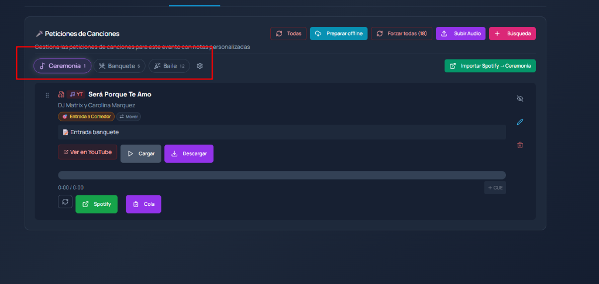
*Figura 9.1: Lienzo de firma táctil con registro de IP, fecha, hora y validez legal.*

---

## 10. Escaleta Musical y Peticiones de los Novios

Planifica la música exacta para cada instante inolvidable de la boda:

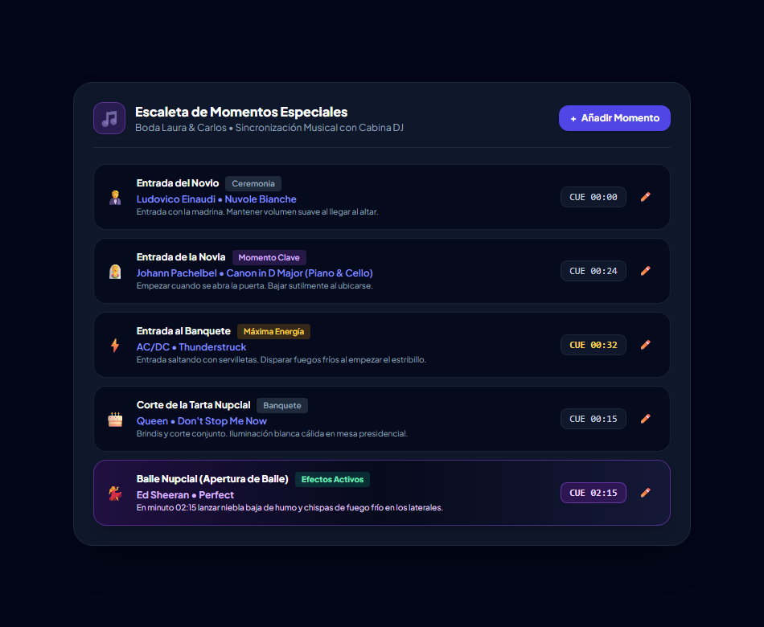
*Figura 10.1: Momentos especiales (Entrada al banquete, Tarta, Ramos, Baile nupcial).*

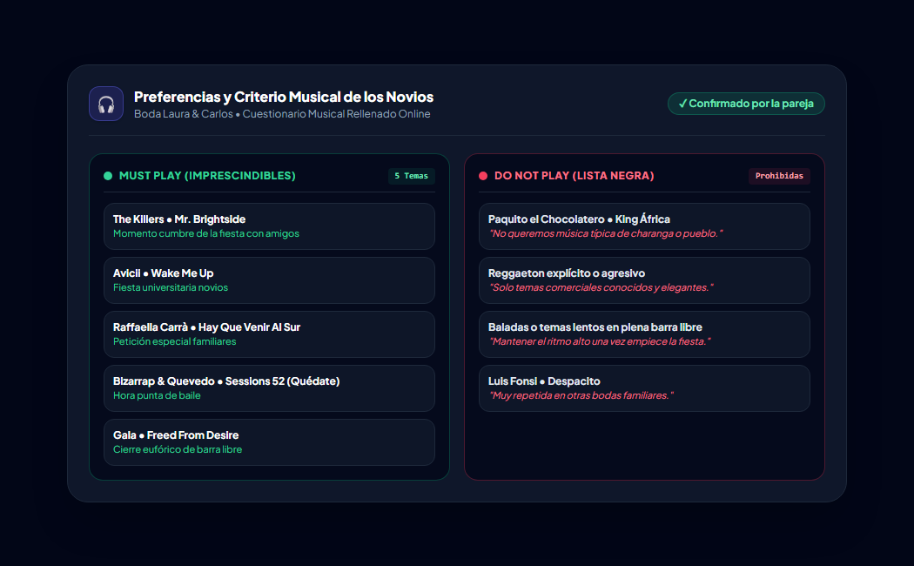
*Figura 10.2: Peticiones Must Play y Do Not Play configuradas por los novios.*

---

## 11. Modo Cabina DJ en Directo y Peticiones QR en Tiempo Real (3s)

Durante la fiesta, el DJ utiliza una pantalla táctil optimizada para cabina (`/live/{token}`):

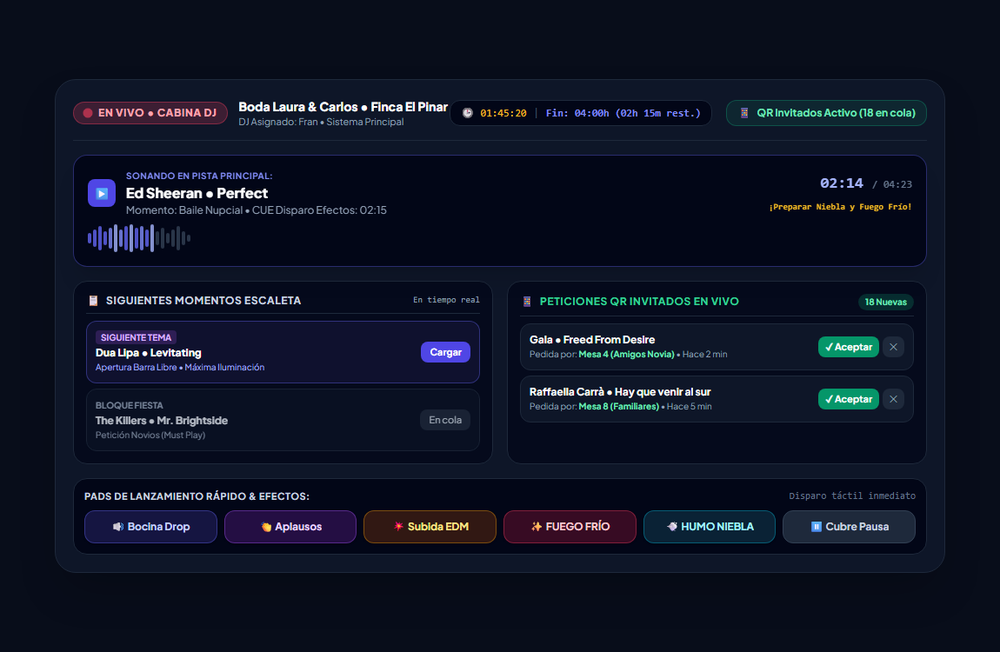
*Figura 11.1: Interfaz en directo para el DJ con escaleta en vivo y cola de peticiones sincronizada cada 3 segundos.*

- **Código QR para Invitados en Tiempo Real (3s)**: Los invitados escanean el QR en las mesas y envían peticiones desde su móvil a `/peticiones/{token}`. En cuanto pulsan enviar, la canción aparece automáticamente en la pantalla del DJ en menos de **3 segundos** sin recargar la página.

---

## 12. Control de Inventario y Material Técnico

Evita olvidos y averías con el módulo de inventario técnico (`/admin/inventory`):

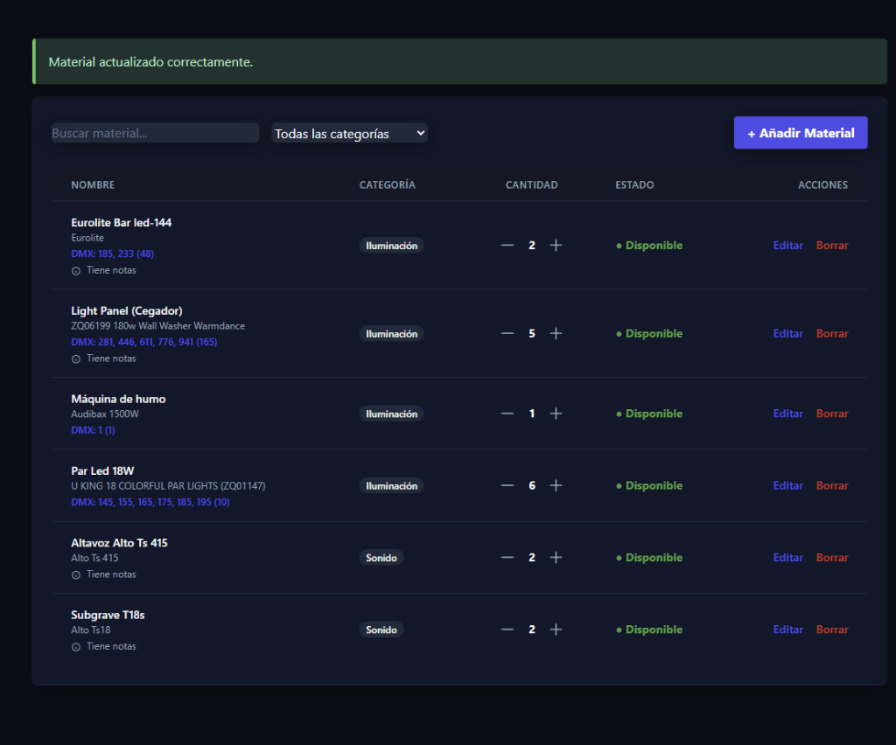
*Figura 12.1: Gestión de altavoces, puentes de luces, máquinas de efectos y packing lists.*

---

## 13. Calculadora Pública de Presupuestos (`/presupuesto`) y Vinculación Inteligente

Captador y configurador web de servicios en `https://app.nunezandson.com/presupuesto` y `https://app.javnxdj.com/presupuesto`:

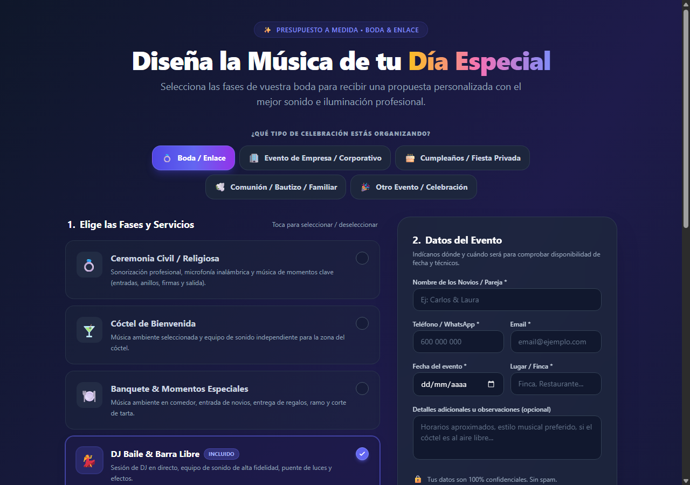
*Figura 13.1: Cotizador interactivo online para seleccionar servicios y generar el presupuesto.*

- **Vinculación Inteligente con Leads Existentes**: Cuando un lead que había entrado por correo recibe el WhatsApp de **1er Contacto + `/presupuesto`** y completa sus servicios en la calculadora, el sistema reconoce automáticamente su ficha por su teléfono o nombre y añade el presupuesto desglosado directamente a su evento existente sin crear eventos duplicados.

---

## 14. Resumen de Buenas Prácticas y Consejos

1. **Responde en el Minuto 1 con "👋 1er Contacto + `/presupuesto`"**: En cuanto recibas el WhatsApp de alerta de nuevo lead, envíales la plantilla de primer contacto para que marquen sus servicios en `/presupuesto`.
2. **Usa las plantillas Madrigal según el día**: Día 3 (Dudas), Día 7 (Escasez 24h), Día 10 (Técnica del NO) y Cierre de Expediente.
3. **Posiciónate ante objeciones de precio**: Utiliza **"👑 No es nuestro cliente (Precio)"** para descartar con elegancia cuando busquen regatear, o **"💰 Objeción Precio (Adaptar)"** si deseas ajustar equipamiento.
4. **Aprovecha el autocompletado de DNI**: Escribe solo los 8 números del DNI en cualquier formulario para que la aplicación calcule la letra automáticamente.

---
*Documento oficial de la plataforma • Desarrollado para Núñez & Son y JAVNXDJ &bull; 2026 (Datos de ejemplo ficticios)*
